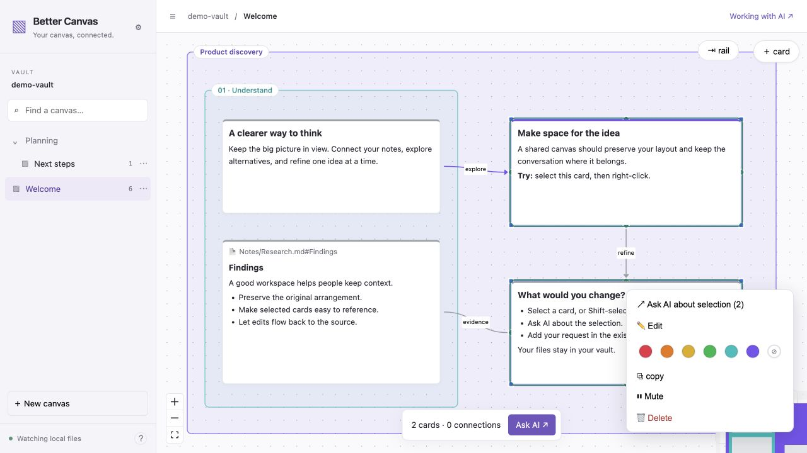

# Better Canvas

An MCP-enabled Obsidian Canvas editor and desktop ChatGPT/Codex plugin, based on [canvai](https://github.com/chuck00lin/canvai).

Open a local vault in the browser, reference selected cards in your existing conversation, and let an AI edit the original `.canvas` files. No additional chat sidebar or Obsidian plugin is required.



## Quick start

Requires Node.js 22.18 or later and npm.

```sh
git clone https://github.com/Xheldon/better-canvas.git
cd better-canvas
npm ci
npm run build
node packages/hub/dist/better-canvas.mjs serve --root /absolute/path/to/vault
```

Open the local address printed by the command. To try the generic sample safely, copy `examples/vault` to a separate folder and point `--root` at that copy.

## ChatGPT / Codex plugin

```sh
npm run plugin:pack
```

This produces `dist/better-canvas-0.2.0.zip`, including the MCP server, browser assets, manifests and skill. The source repo includes a local marketplace at `.agents/plugins/marketplace.json`; build and package before installing from it. Only the allowlisted package folder is installed, not the source checkout or local test files. The packaged plugin requires Node.js on the user's computer but does not require `node_modules` or an AI API key.

For Codex CLI, install the built local package with:

```sh
codex plugin marketplace add .
codex plugin add better-canvas@better-canvas-local
```

For a prebuilt release, extract the ZIP and run those two commands from the extracted `better-canvas` folder instead; no build or npm install is needed. Both the source checkout and release include a local marketplace. Desktop clients that support local marketplaces can discover it through their Plugins Directory; restart the client if necessary, select the **Better Canvas** source, and install the plugin there. Client availability varies by version and surface.

Then start a new chat and ask Better Canvas to open your vault. The AI calls `open_vault`, `start_preview`, and opens the returned URL in its browser panel. The release has been tested through a real stdio MCP client; installation into the current ChatGPT/Codex chat is not automatic.

GitHub distribution is separate from OpenAI's public plugin directory. A public directory listing is **not** included. See the official [plugin packaging](https://developers.openai.com/plugins/build/plugins) and [desktop-only plugin](https://developers.openai.com/plugins/deploy/desktop-only) instructions for current installation and submission requirements.

For any other MCP client, configure a stdio server:

```json
{
  "mcpServers": {
    "better-canvas": {
      "command": "node",
      "args": ["/absolute/path/to/better-canvas/packages/hub/dist/better-canvas.mjs", "mcp", "--select-vault"]
    }
  }
}
```

`--select-vault` starts without opening any vault. The `open_vault` tool selects the folder for the current MCP process. Alternatively, pass `mcp --root /absolute/path/to/vault` for a fixed folder.

## Point at a card, keep talking in your chat

1. Select a card, or hold Shift and drag to select several.
2. Right-click → **Ask AI about selection**.
3. Copy the reference into your chat and describe the change.
4. The AI calls `read_reference`, reads the current board revision, and edits only the requested nodes.

`get_selection` also exposes the current browser selection. Native browser annotations can identify DOM elements through stable card IDs. The page does not claim access to the host's chat input or its native attachment format.

## What is included

- Compact, searchable Canvas file tree and a canvas-focused browser interface.
- Node references, multi-selection, and MCP tools for cards, connections and linked notes.
- Saved-file synchronization with Obsidian, including linked Markdown and images.
- Required revision checks, recoverable browser drafts, and local recovery history.
- Original coordinates, dimensions, node order, nested groups, connection sides and endpoint arrows.
- Heading and paragraph-block excerpts for linked Markdown.
- Preservation of unknown JSON fields and existing file formatting during edits.

Rendering follows JSON Canvas geometry. It does **not** reproduce arbitrary Obsidian themes, plugin-generated content, or every Markdown extension. See [compatibility and synchronization](docs/compatibility.md) for the precise boundaries and [privacy](docs/privacy.md) for local data handling.

## Development

```sh
npm ci
npm run typecheck
npm test
npm run build
npm run plugin:pack
npm run test:package
```

See [verification scope](docs/testing.md) for automated and manual acceptance checks.

The upstream canvas engine, MCP operations, React Flow editor, and file watcher are retained and extended. `packages/canvas-kit` contains file-format and layout operations; `packages/hub` contains local services and MCP; `packages/web` contains the editor.

MIT. Original canvai license and Git history are retained. See [NOTICE](NOTICE).
