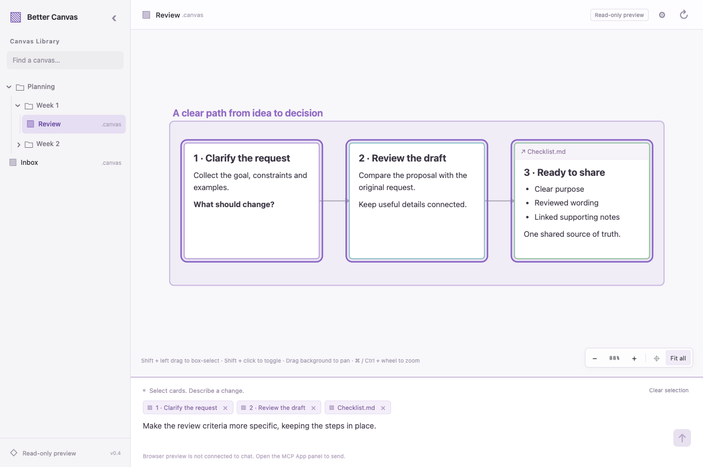

# Better Canvas

A read-only JSON Canvas viewer with AI editing over MCP. Works with Obsidian vaults and ordinary folders.

Select cards, describe a change in the bottom composer, and let the AI in your current conversation update the source files. The preview follows the files on disk.

Built with **React, TypeScript and Vite**. Cards use an HTML layer and connections use SVG. There is no embedded canvas editor, automatic layout engine, separate chat sidebar, or spawned AI process.

## Open a Canvas in your chat

After installing Better Canvas, open the local chat where you want to edit a Canvas in the ChatGPT desktop app. [Installation steps](#install)

1. In the **chat message box**, type `@Better Canvas` and **select Better Canvas from the suggestions**. In the same message, ask `Open Welcome.canvas in the right panel`, using your own Canvas filename.
2. If Better Canvas appears as a card in the chat, expand it into the right panel. On first use, open **Settings → Working directory**, enter the full path to your Obsidian vault or Canvas folder, and choose your file in the sidebar.
3. Look below the panel’s input for **Connected to this chat**. Select a card, type a request such as `Rename this card to Next steps`, and press **Enter** or click **↑** to send. **Shift + Enter** adds a new line.

You can switch Canvas files in the connected panel’s sidebar and keep editing in the same chat. When you want a panel in another chat, you can mention `@Better Canvas` there.

**Why is Send disabled at `127.0.0.1` or `localhost`?** That address opens the standalone viewer, even in ChatGPT’s right-hand browser. It supports browsing and card selection. To send an edit request, open the plugin from the chat message box as in step 1. The macOS **Open With** menu on a file link lists external applications.

<details>
<summary>中文快速上手</summary>

1. 在 ChatGPT 桌面应用左侧的聊天输入框键入 `@Better Canvas`，**点选候选列表里的插件**，再发送「在右侧打开 Welcome.canvas」。把文件名换成自己的画布名。
2. 如果聊天里出现插件卡片，展开到右侧。首次使用时，在「设置 → 工作目录」填入 Obsidian 仓库或画布文件夹的完整路径，再从侧栏选择画布。
3. 面板底部显示 **Connected to this chat（已连接当前聊天）** 后，选中卡片，在底部输入修改要求，按 **回车** 或点 **↑** 发送。**Shift + 回车** 可以换行。

同一个面板里，切换画布后可以直接继续编辑。想在另一条聊天里编辑时，可以在那条聊天里再次点选 `@Better Canvas`。

画布打开时读取一次。修改卡片会刷新当前画布，只有附件本身发生变化时才重新加载对应图片或笔记。AI 写入前会重读磁盘文件，保留其他人的改动。目标卡片、连线或文件已删除时，面板会弹出提示，整批修改都会停止。

即使是在右侧浏览器里，`127.0.0.1` 或 `localhost` 地址也只提供网页预览，发送按钮会保持灰色。Mac 上文件链接的「打开方式」列出的是本机应用。要发起 AI 修改，请从聊天输入框打开插件面板。

</details>



## How it works

Click a card to select it, Shift-click to add or remove a card, or hold Shift and drag with the left mouse button from a card or empty space to add all cards intersecting the rectangle. Selected cards appear as reference chips above the input. When typing with an IME, Enter confirms the current composition before it can submit the request.

When you send, the host receives the request and a stable reference to those cards. Edits use the saved file at write time. Independent changes are preserved. If a target has disappeared, the panel shows a warning and the entire batch stops. A change to the same field prompts the AI to reread it and revise its patch.

Opening a board loads its content and linked previews once. The panel listens for file changes. Editing a card keeps cached illustrations, and replacing an attachment refreshes just that attachment. The refresh button also reloads the current view.

The sidebar preserves the original folder hierarchy and shows only Canvas files and their ancestor folders. Search keeps that hierarchy. Hidden folders and common generated folders are excluded. Settings are available even when the sidebar is collapsed.

The browser cannot move, resize, edit, delete, create, upload or paste cards. It has no content-writing HTTP endpoints. View metadata and directory preferences are stored separately.

Hold Cmd on macOS (Ctrl on Windows/Linux) while scrolling to zoom around the pointer. Scroll without a modifier to pan. Selection and zoom never change card positions in the source file.

### Two ways to view

| Surface | Preview and selection | Send to current chat |
| --- | --- | --- |
| MCP App panel in a compatible host | Yes | Uses the standard `ui/message` bridge |
| Local browser / localhost preview | Yes | Disabled: ordinary web pages do not have the host chat bridge |

The composer only reports a successful send after the host acknowledges it. A failed send retains the draft. Sending a request does not mean AI has applied it yet.

The plugin declares conversation-panel and `.canvas` file-viewer entrypoints through the OpenAI MCP UI extension, with fullscreen as the preferred presentation. File viewers resolve the exact file from host-provided metadata and enforce the selected vault boundary. Host support and plugin loading determine whether these entrypoints are available. Installing or updating a local plugin does not automatically reload an already-running conversation's MCP connection.

**Verified on one desktop environment:** on 2026-11-18, a user submitted a selected-card request through the native panel to the current conversation. AI resolved its immutable reference and edited the file through MCP; Obsidian's open Canvas and the panel's reported revision both updated. This was tested with ChatGPT desktop 26.1111.21308 (27194), Node.js 22.23.1 and Obsidian 1.15.1 on macOS. Other hosts and desktop versions are not covered by that result; see [testing](docs/testing.md).

If the chat shows file data and you still need the panel, select the plugin by name in that chat and ask it to open the file. [Open a Canvas in your chat](#open-a-canvas-in-your-chat)

On Codex builds that expose the experimental `enable_mcp_apps` feature, check it with `codex features list`. Enable it with `codex features enable enable_mcp_apps` if needed, then restart the desktop host and reopen the conversation so both the feature and updated plugin connection load. This enables UI support; it does not change MCP tool approvals. A CLI feature value alone does not establish that the desktop panel mounted successfully.

## Install

Requires **Node.js 22.18 or later**.

Download and unzip the [latest release](https://github.com/Xheldon/better-canvas/releases). The archive contains the complete server, browser UI and MCP App UI; no dependency installation is required.

For the Codex desktop local-plugin workflow:

```sh
codex plugin marketplace add /absolute/path/to/better-canvas --json
codex plugin add better-canvas@better-canvas-local --json
```

Then select `@Better Canvas` in the chat where you want to edit. The plugin remembers the working directory you choose in Settings or ask the AI to open. [Open a Canvas in your chat](#open-a-canvas-in-your-chat)

For an Obsidian vault, select the **entire vault root**: its image/note paths are vault-relative. For an ordinary folder, references are relative to the selected working directory. The viewer never searches parent directories for missing assets. Switching directories clears the current selection and unsent draft; old references cannot edit a same-named file in the new directory.

See [installation and distribution](docs/distribution.md) for release ZIPs, source installation, and the official plugin-directory submission route.

For other MCP clients, register a stdio server:

```json
{
  "mcpServers": {
    "better-canvas": {
      "command": "node",
      "args": [
        "/absolute/path/to/better-canvas/packages/hub/dist/better-canvas.mjs",
        "mcp",
        "--select-vault"
      ]
    }
  }
}
```

Clients without MCP Apps can use the MCP tools and local read-only preview. The standalone composer does not pretend to send messages.

## Local development

```sh
npm ci
npm run build
node packages/hub/dist/better-canvas.mjs serve --root /absolute/path/to/vault --port 5199
```

Open `http://127.0.0.1:5199`. The server binds to loopback only. Use `?lang=en` or `?lang=zh` to override the browser language.

```sh
npm run typecheck
npm test
npm run build
npm run plugin:pack
npm run test:package
```

## MCP tools

- **Scope:** `open_vault`, `set_directory` (Settings), `list_boards`, `set_active_board`, `get_active_board`.
- **View:** `open_canvas` (MCP App), `start_preview` (browser), `get_preview`, `preview_file`.
- **File entrypoint:** `get_opened_canvas` is app-only and requires the host's `openai/resource.path` metadata.
- **Reference:** `save_selection`, `get_selection`, `create_reference`, `read_reference`.
- **Read/write through AI:** `read_board`, `apply_ops`, `create_board`, `read_note`, `update_note`.

Write tools are model-only in the MCP Apps visibility metadata. A normal MCP client remains responsible for authorizing its own tool calls.

Example after `read_board`:

```json
{
  "board": "Planning.canvas",
  "workspaceId": "<workspaceId returned by read_board>",
  "expectedRevision": "<revision returned by read_board>",
  "ops": [
    { "op": "update_node", "id": "card-id", "patch": { "text": "Updated text" } }
  ]
}
```

Operations include adding, updating and deleting nodes and edges. Adding needs complete records and explicit coordinates. Deleting a node also removes its attached edges. There is no implicit layout. Version 0.3 replaces the former semantic/rail operations; update clients to use `patch` objects.

Version 0.4 also requires `workspaceId` for content writes, file previews, selection/reference creation and setting the active board. Obtain it from a current preview/read response. A stale working directory is rejected even when both directories contain identical Canvas bytes. Existing stable references remain readable in their original directory.

## Illustrated flowcharts

Use a standard JSON Canvas `file` node for a local image, positioned beside the step it explains. A group rectangle can contain both cards; flow arrows continue connecting the steps. Referencing an image file does not create an edge.

If the AI host supports image generation and saving local files, it can save the generated image inside the working directory and add its file node through MCP. Better Canvas does not bundle a generation model or an upload endpoint. Existing PNG, JPEG, WebP, GIF and AVIF files are previewed (up to 5 MB each). Text-card image embeds are not rendered; use a file card. See [compatibility](docs/compatibility.md).

## Fidelity and storage

Original IDs, coordinates, dimensions, array order, group boundaries, edge sides and arrow ends are retained. Unknown JSON properties survive targeted edits. File serialization retains the detected indentation, colon spacing and final newline convention.

Rendering is structurally compatible with JSON Canvas, not a copy of Obsidian's renderer. Fonts, line wrapping, curve routing, custom themes, embeds and third-party plugin visuals may differ. See [compatibility](docs/compatibility.md).

Files on disk are the source of truth. The plugin rechecks the saved revision immediately before replacement and keeps recovery copies. If Obsidian is between renames during a save, the writer briefly retries the same path. A permanently missing file stops the edit. Obsidian manages its own unsaved buffers and file locks.

See [privacy](docs/privacy.md) and [testing](docs/testing.md).

## Provenance

The project began as a canvai fork. Version 0.3 replaces its application framework, renderer, editor interactions, layout system and agent spawning. The JSON Canvas parsing/formatting code retains ideas and portions from the MIT-licensed project. The license and attribution remain in [NOTICE](NOTICE); the Git history is retained.

MIT License.
